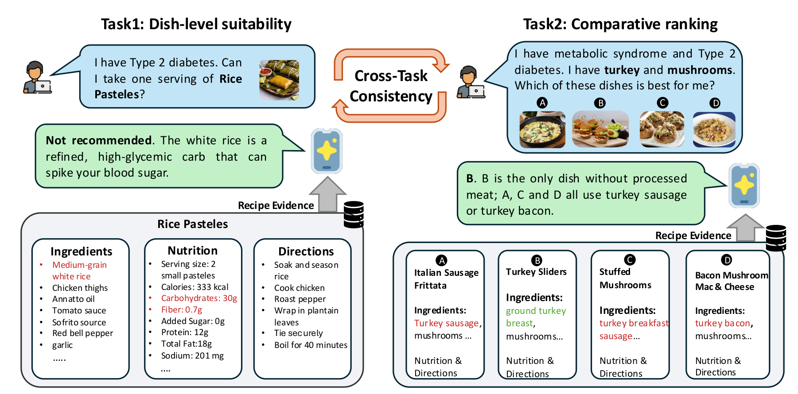
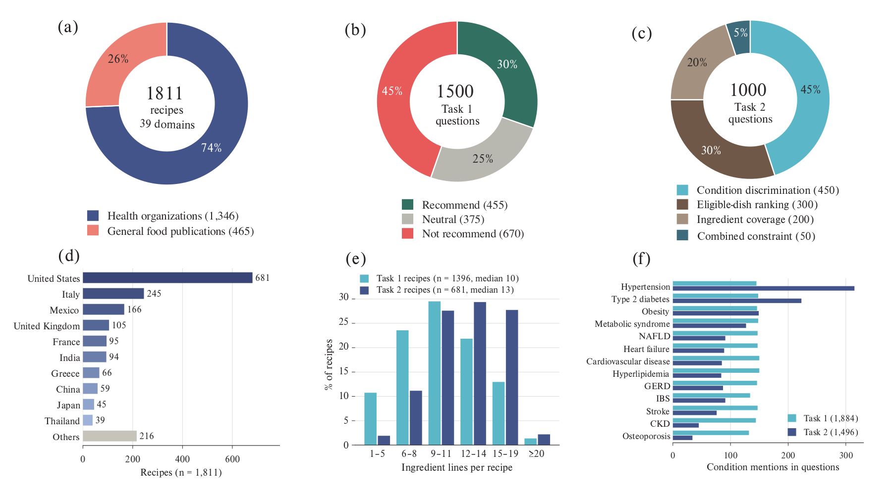

# FAM-Bench: A Multimodal Benchmark for Condition-Aware Food-as-Medicine Reasoning

**Anonymous code and data release for double-blind review.**

FAM-Bench tests whether vision-language models can decide if a concrete dish
suits a person with a diet-related health condition, and ground that decision
in the dish's ingredients. It has 2,500 questions over 13 health conditions:

- **Task 1 — Dish-level suitability assessment** (1,500 questions). Given one
  dish (recipe and/or photo) and one or two health conditions, classify the
  dish as *recommend* / *neutral* / *not recommend* and list, per condition,
  the ingredients that drive the decision.
- **Task 2 — Comparative dish analysis** (1,000 questions). Given one to three
  health conditions, the ingredients a user has on hand and four candidate
  dishes, rank the dishes from best to worst.

Conditions: cardiovascular disease, chronic kidney disease, GERD, heart
failure, high LDL cholesterol (hyperlipidemia), hypertension, IBS, metabolic
syndrome, nonalcoholic fatty liver disease, obesity / weight management,
osteoporosis, stroke, type 2 diabetes.

Both tasks are run under four prompting modes — `baseline`, `cot` (chain of
thought), `ki` (knowledge injection from the bundled knowledge base) and
`cot_ki` — and three input settings: recipe text (**R**), dish photo with its
title (**P**), and both (**R+P**).



## Repository layout

```
Food-as-medicine/
├── dataset/
│   ├── task1_dish_suitability.json      # 1,500 Task 1 questions
│   ├── task2_comparative_analysis.json  # 1,000 Task 2 questions
│   ├── ctc_items.json                   # 3,047 Task 2 options as Task 1 questions (cross-task consistency)
│   └── vision_probe_gt.json             # ingredient / cooking-method ground truth of the Task 1 recipes
├── knowledge_base/
│   └── disease_food_kb.json             # per-condition food lists used by ki / cot_ki (both tasks)
├── figures/                             # overview.png, statistics.png (shown below)
├── code/
│   ├── task1/   run_task1.py (entry point), core.py, knowledge.py, llm_providers.py, image_utils.py,
│   │            scripts/run_task1.sh (sweep over models / modes / settings)
│   ├── task2/   evaluate.py (entry point), ranker/ (prompts, parsing, scoring, providers, ...),
│   │            scripts/run_task2.sh (sweep)
│   ├── ctc/     score_ctc.py (cross-task consistency)
│   └── vision_probe/  run_probe.py, score_probe.py, common.py
├── requirements.txt, .env.example
└── LICENSE-CODE, LICENSE-DATA
```

## Data



*(a) Recipe sources; (b) Task 1 gold decisions; (c) Task 2 question types;
(d) cuisine of the recipes; (e) ingredient lines per recipe; (f) how often
each condition is asked in each task.*

### Task 1 — `dataset/task1_dish_suitability.json`

A JSON list of 1,500 questions, one dish and one question each:

```json
{
  "id": "t1_0001",
  "title": "Butternut squash casserole",
  "question": "Is this dish suitable for someone managing IBS?",
  "ingredients": ["2 tbsp olive oil", "1 onion, sliced", "2 garlic cloves, crushed", "..."],
  "nutrition": {"calories": "313 kcal", "sodium": "185 mg", "saturated fat": "1 g", "...": "..."},
  "dietary_tags": ["vegetarian"], "meal_type": ["dinner"], "notes": null,
  "image_url": "https://...", "url": "https://...",
  "conditions": ["ibs"],
  "standard answer": {
    "decision": "not recommend",
    "rationale_ingredients": [{"condition": "ibs", "ingredients": ["garlic"]}],
    "rationale_lines": {"ibs": [2]}
  }
}
```

The model sees `title`, `question`, `ingredients`, `nutrition` (per serving),
`dietary_tags`, `meal_type` and `notes` in the text settings, and the photo at
`image_url` in the photo settings (with only `title` and `question` in P).
`servings`, `serving_size` and `instructions` are also included.

Gold decisions follow one rule over the asked conditions: *not recommend* if
any condition has a limit/avoid ingredient or an out-of-range per-serving
nutrient value; *recommend* if every condition has a beneficial ingredient and
the applicable nutrient values are present and acceptable; *neutral*
otherwise. Split: 670 not recommend / 455 recommend / 375 neutral.
`rationale_ingredients` lists the ingredients behind the decision for each
asked condition (empty when the decision rests on nutrient values or nothing
matched); `rationale_lines` gives the indices of the recipe ingredient lines
they come from, which the rationale score compares against.

### Task 2 — `dataset/task2_comparative_analysis.json`

`questions` is a list of 1,000 four-option questions (`metadata` holds counts).
Abridged example:

```json
{
  "question_id": "crmcq_038",
  "question_type": "health_condition_discrimination",
  "prompt": {
    "conditions": ["chronic kidney disease"],
    "condition_labels": ["Chronic Kidney Disease (CKD)"],
    "available_ingredients": ["spinach", "egg", "mushroom"]
  },
  "options": [
    {"letter": "A", "recipe_id": 4154, "title": "Italian Sausage Frittata",
     "ingredients": ["1/4 lb Italian turkey sausage, sliced into 1/2-inch pieces", "..."],
     "image_url": "https://...", "url": "https://...", "nutrition": {"sodium_mg": "...", "...": "..."},
     "gold": {"decision_label": "not_recommend", "failure_mode": "condition_violation",
              "condition_violation": "chronic kidney disease: contains 'processed meats'",
              "ingredient_match": true, "health_score": 0.785}},
    {"letter": "B", "title": "Lentils with Mushrooms and Poached Eggs", "...": "...",
     "gold": {"decision_label": "recommend", "failure_mode": "valid",
              "condition_violation": null, "ingredient_match": true, "health_score": 0.7647}},
    {"letter": "C", "title": "Spinach Mushroom Egg and Ham Cups", "...": "..."},
    {"letter": "D", "title": "Simple frittata", "...": "..."}
  ],
  "answer": {"letter": "B", "recipe_id": 3633, "title": "Lentils with Mushrooms and Poached Eggs"},
  "gold": {"ranking": ["B", "A", "C", "D"],
           "decision_labels": {"A": "not_recommend", "B": "recommend", "C": "not_recommend", "D": "not_recommend"}}
}
```

The model sees the conditions (`condition_labels`), the available ingredients,
each option's `title`, and its `ingredients` (R, R+P) and/or photo (P, R+P).
Question types: health-condition discrimination (450; distractors violate a
condition), ranking among clinically eligible dishes (300; all four pass),
ingredient-coverage discrimination (200; distractors miss an available
ingredient) and combined constraints (50). The gold ranking orders options
without a condition violation first, then options containing all available
ingredients, then by a nutrition-based `health_score` that the model does not
see. Top-1 accuracy is scored against `answer.letter`.

**Photos.** Photos are not redistributed; each option's `image_url` points to
the photo used in the paper. For 28 of the 681 recipes no public photo shows
the dish (their source pages show a different dish) and the paper used a
manually supplied photo; their `image_url` is `null`, which affects 120
questions. In the photo settings, either put photos named `<recipe_id>.<ext>`
in `dataset/task2_images/` (`--image-dir`; a local photo is used before the
URL) or pass `--skip-unavailable-images` to score the other questions. Some
recipe sites rate-limit automated downloads (HTTP 403): use a low
`--concurrency` and `--resume`. `--image-check-only` lists the photos that
cannot currently be obtained, without calling a model.

### Knowledge base — `knowledge_base/disease_food_kb.json`

For each of the 13 conditions: `recommend` (beneficial foods), `not_recommend`
(foods to limit or avoid), `strictly_avoid`, `aliases` and `nutrient_limits`,
plus general nutrient limits from the Dietary Guidelines for Americans. The
`ki` / `cot_ki` modes of both tasks inject the `recommend` / `not_recommend`
lists of the conditions named in a question.

## Setup

```bash
# Python >= 3.10
python -m venv .venv && source .venv/bin/activate
pip install -r requirements.txt
cp .env.example .env    # fill in the API keys of the providers you use
```

Open-weight models are served with [vLLM](https://github.com/vllm-project/vllm)
and called with `--provider vllm --model <served model name>`; the server
address defaults to `http://localhost:8000/v1` (`VLLM_BASE_URL` overrides it).
For example:

```bash
vllm serve Qwen/Qwen3-VL-8B-Instruct --max-model-len 16384 \
    --limit-mm-per-prompt '{"image": 4}'      # four photos per Task 2 question
# Qwen3.5: add --default-chat-template-kwargs '{"enable_thinking": false}'
```

## Quick start (5 questions)

```bash
# Task 1, recipe text, baseline
python code/task1/run_task1.py --provider openai --model gpt-5.4 \
    --mode baseline --input-mode text --limit 5

# Task 2, recipe text (titles + ingredient lists), baseline
python code/task2/evaluate.py --provider openai --model gpt-5.4 \
    --prompt-mode baseline --input-mode text --include-recipe-ingredients --max-questions 5
```

## Running the evaluations

Models evaluated in the paper: GPT-5.4 (`openai:gpt-5.4`), Claude Sonnet 4.6
(`anthropic:claude-sonnet-4-6`), and, served with vLLM, Gemma-3-12B-IT,
Gemma-3-27B-IT, Gemma-4-31B-IT, Qwen3-VL-8B-Instruct, Qwen3-VL-32B-Instruct
and Qwen3.5-27B. The released code calls every model at temperature 0 with
hidden reasoning off.

| Setting | Task 1 (`run_task1.py`) | Task 2 (`evaluate.py`) |
|---|---|---|
| R (recipe text) | `--input-mode text` | `--input-mode text --include-recipe-ingredients` |
| P (title + photo) | `--input-mode image_only` | `--input-mode image` |
| R+P | `--input-mode text_image` | `--input-mode image --include-recipe-ingredients` |

Prompting mode: `--mode` (Task 1) / `--prompt-mode` (Task 2), one of
`baseline`, `cot`, `ki`, `cot_ki`. The sweep scripts loop over models, the four
modes and the requested settings; `INPUTS` takes the names `text`,
`image_only`, `text_image` for both tasks:

```bash
# GPT-5.4 and Claude Sonnet 4.6 (keys from .env), all four modes, recipe text
bash code/task1/scripts/run_task1.sh
bash code/task2/scripts/run_task2.sh

# one vLLM-served model, all three settings
MODELS="vllm:Qwen/Qwen3-VL-8B-Instruct" INPUTS="text image_only text_image" \
    bash code/task1/scripts/run_task1.sh
```

A run is scored only when every question has a model answer. If any call
fails (API error, timeout, unobtainable photo), the runner writes no metrics
and exits non-zero; rerun the same command with `--resume` (`RESUME=1` for the
sweep scripts) to call only the failed questions. An answer that cannot be
parsed is a model error and counts as wrong.

## Outputs and metrics

**Task 1** writes one JSON file per run to `runs/task1/`
(`task1_<mode>_<input>_<provider>_<model>.json`): per-question records
(`results`) and aggregate `metrics`.

- **Decision:** `decision_macro_f1` (macro-F1 over the three classes, the
  headline metric given the class imbalance) and `decision_accuracy`, plus
  per-class scores and the confusion matrix.
- **Rationale:** `rationale_macro_f1` / `rationale_micro_f1` over (condition,
  ingredient) pairs, matched at the level of recipe ingredient lines: each
  cited ingredient name is mapped to the recipe line(s) it names and compared
  with `rationale_lines`, and each condition name to the asked condition it
  names. The macro average covers the questions whose gold lists at least one
  ingredient; `--rationale-match exact` compares exact strings instead.

**Task 2** writes `<stem>.jsonl` (one row per question), `<stem>.csv`,
`<stem>_summary.json` and, when needed, `<stem>_debug.jsonl` to
`runs/task2/<provider>/<model>/<mode>/`. The summary gives top-1 accuracy and
the mean reciprocal rank (MRR) of the gold best option over all questions (an
unparsable answer scores 0), per-question-type and per-condition breakdowns,
and Kendall's tau against the full gold ranking. Option letters are shuffled
per question with a fixed seed to remove position bias (`--no-debias` keeps
the dataset order).

## Cross-task consistency (CTC)

CTC asks whether a model's Task 2 ranking agrees with its own Task 1 decisions
on the same dishes. `dataset/ctc_items.json` turns every (recipe, condition
set) that appears as a Task 2 option into a Task 1 question: 3,047 items with
the Task 1 recipe fields (`title`, `ingredients`, `nutrition`, `dietary_tags`,
`meal_type`, `notes`), the Task 1 question wording, the Task 2 photo at
`image_url`, and `recipe_id` / `conditions` linking each item back to its
Task 2 options. The items carry no gold label; only the model's own decisions
are used.

```bash
# 1. Task 1 decisions on the CTC items (same runner, prompts and modes as Task 1)
OUT_DIR=runs/ctc EXTRA_ARGS="--input-path dataset/ctc_items.json" \
    bash code/task1/scripts/run_task1.sh
# 2. Task 2 rankings of the same models and modes (setting R), if not run yet
bash code/task2/scripts/run_task2.sh
# 3. Score
python code/ctc/score_ctc.py            # -> runs/ctc/ctc_summary_text.csv
```

For each Task 2 question, every pair of options is ordered by the model's
ranking and compared with its decisions on the two options (recommend >
neutral > not recommend); pairs with equal decisions are skipped. `ctc` is the
share of the remaining pairs, pooled over all questions, on which the ranking
agrees (chance 50); `ctc_strict` keeps only (recommend, not recommend) pairs.
Runs are matched by the provider, model and mode recorded in the result files.
The paper reports the text setting (`--input text`, the default); `--input
text_image` pairs photo-augmented runs.

## Vision probe

The probe asks a model to name the ingredients and cooking methods it sees in
each Task 1 dish photo (1,320 photos of 1,382 recipes), from the photo alone
(`image`) or with the dish title (`image_title`, the information of Task 1's
P setting), and scores the answer against the recipe.
`dataset/vision_probe_gt.json` holds, per recipe `url`, the ingredients
(`name`, generic `base`, `visible` — whether this photo shows it, `optional`,
source `line`), the `cooking_methods` and the defining `final_method` (11
labels, 5 coarse groups; see `code/vision_probe/common.py`), and whether the
methods come from the instructions (`method_source`). It was annotated from the
recipe text by an LLM, and the `visible` flags were then checked against each
photo (details in the paper).

```bash
python code/vision_probe/run_probe.py --provider openai --model gpt-5.4
python code/vision_probe/run_probe.py --provider vllm --model Qwen/Qwen3-VL-8B-Instruct
python code/vision_probe/score_probe.py --tag probe_v1   # -> runs/vision_probe/probe_v1/summary_lenient.csv
```

Predictions go to `runs/vision_probe/<tag>/pred_<condition>_<model>.jsonl`; a
rerun calls only the photos without an answer. The summary reports, per model
and condition, recall of the visible ingredients (`recall_visible`), of the
others (`recall_hidden`) and of the Task 1 gold rationale ingredients
(`recall_rationale`), ingredient `precision`, and `final_acc` /
`final_group_acc` for the cooking method. Subset `main` leaves out photos shared
by several recipes, and every model is scored on the photos that all runs in the
tag answered. `--match strict` turns off partial-name matching.

## License

| Path | License |
|---|---|
| `code/` | MIT (`LICENSE-CODE`) |
| `dataset/`, `knowledge_base/` | CC BY 4.0 (`LICENSE-DATA`) |

Recipe texts in the dataset and the photos it links to remain the property of
their original publishers and are provided for research use only.
